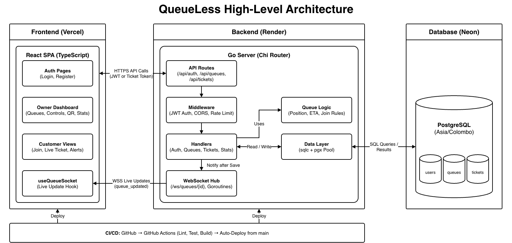

# QueueLess

A virtual queue web app that lets customers join a shop's queue from their phone and wait anywhere, instead of sitting in the shop.

## Problem

- Small shops (barbers, salons, repair shops, phone repair counters) use a physical waiting line.
- Customers sit for 30–90 minutes without knowing their position or wait time.
- Shop owners lose customers who walk away when they see a crowd.
- Existing queue systems are paid and too complex for a small shop.

## Features

QueueLess has two sides: a customer view (no login) and an owner dashboard (login).

1. Owner registers, logs in and creates a shop queue.
2. The app generates a QR code and a share link for the queue.
3. Customer joins at the shop (QR) or from home (link), enters a name and gets a ticket number.
4. Customer sees their live position with an estimated wait time.
5. Owner clicks **Call next**, **Skip** or **Mark done**, and every screen updates instantly.
6. Owner can pause or close the queue.
7. **Queue settings:** allow or block remote joins, and set a maximum queue size.
8. **Arrival check-in:** remote customers tap **I'm here** on arrival, and the owner sees who is present.
9. **Turn alert:** customers get a notification when two people are ahead.
10. **Stats page:** customers served today and average wait.

## Tech stack

| Layer | Technology |
| --- | --- |
| Frontend | React, TypeScript, Vite, React Router, TanStack Query, Tailwind CSS, qrcode.react |
| Backend | Go, Chi, gorilla/websocket, pgx, sqlc, golang-migrate, golang-jwt, bcrypt |
| Database | PostgreSQL |
| Testing | Go `testing`, testify, Vitest, React Testing Library, Playwright |
| DevOps | Docker, Docker Compose, GitHub Actions |
| Hosting | Vercel (frontend), Render (backend), Neon (database) |
| API docs | OpenAPI 3.1 |

All times use Sri Lanka Standard Time (`Asia/Colombo`, UTC+05:30).

## Architecture

