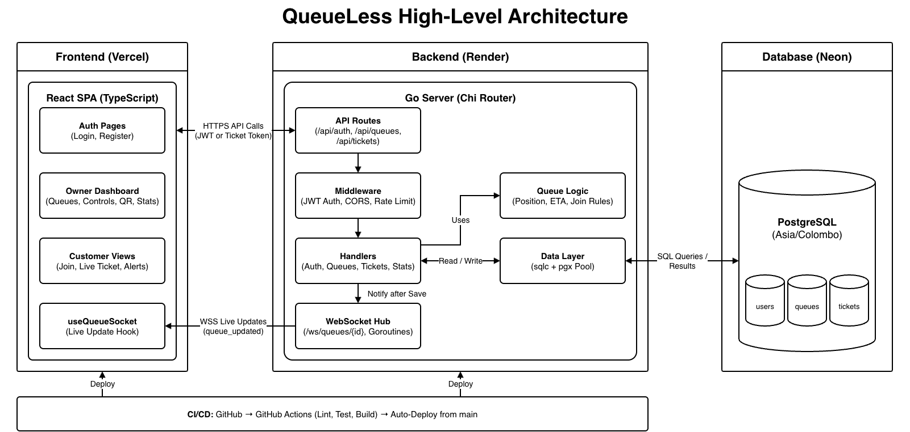

# QueueLess – Architecture

The diagram source is [`architecture.drawio`](architecture.drawio). Open it in [draw.io](https://app.diagrams.net), edit it, then export it over `architecture.png`.

## How it works

- **Frontend (Vercel):** a React single-page app with the owner dashboard and the customer views.
- **Backend (Render):** one Go server holds both the REST API and the WebSocket hub, so there are no extra services to run.
- **Database (Neon):** PostgreSQL stores users, queues and tickets. Every connection runs in `Asia/Colombo`.
- **CI/CD:** GitHub Actions runs the checks, and merging to `main` deploys the frontend and backend.

## How a change reaches every screen

1. The browser sends a request to the REST API over HTTPS.
2. Middleware checks the request, then a handler applies the queue rules.
3. The data layer saves the change in PostgreSQL.
4. The handler notifies the WebSocket hub.
5. The hub pushes `queue_updated` to every open browser over WSS.
