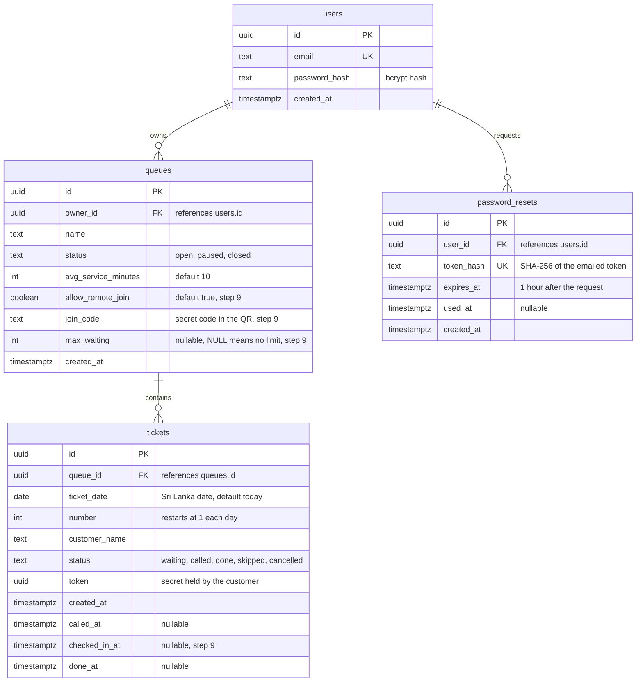

# QueueLess – ER Diagram

Final schema for the MVP. Columns marked `step 9` are added by the second migration.

## Relationships

| From | To | Cardinality | Meaning |
| --- | --- | --- | --- |
| `users` | `queues` | One to zero or many | An owner can run many queues; each queue has exactly one owner. |
| `queues` | `tickets` | One to zero or many | A queue holds many tickets; each ticket belongs to exactly one queue. |
| `users` | `password_resets` | One to zero or many | An owner can request reset links; each link belongs to exactly one owner. |

## Constraints

- `UNIQUE(queue_id, ticket_date, number)` on `tickets`, so numbers restart at 1 each Sri Lanka day.
- `waiting` or `called` tickets left from an earlier day become `cancelled`.
- `CHECK` constraints limit `queues.status` and `tickets.status` to the listed values.
- Index on `tickets(queue_id, status)`.
- All times are `timestamptz`, stored through connections running in `Asia/Colombo`.
